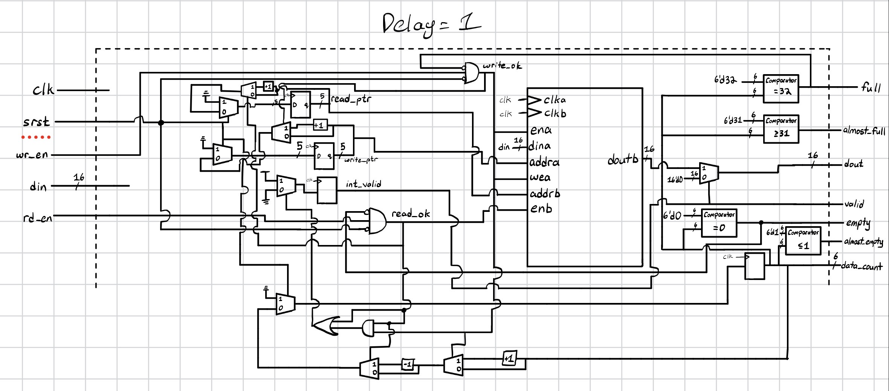
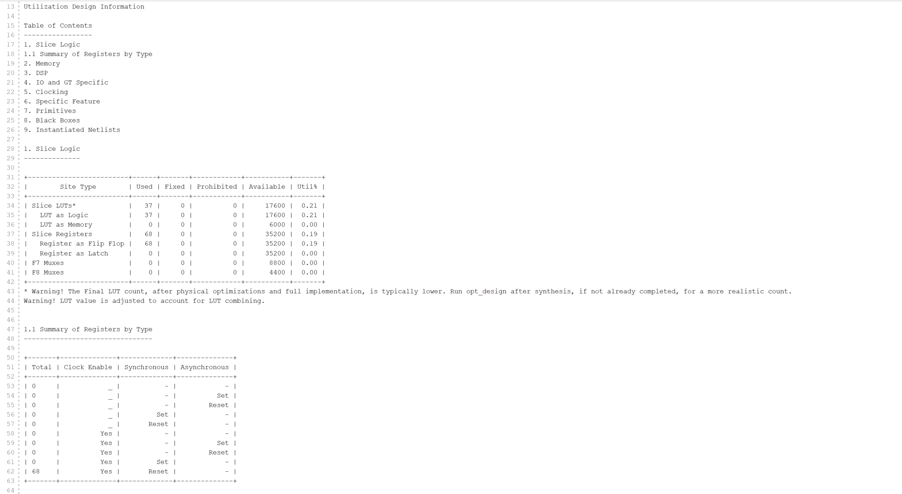
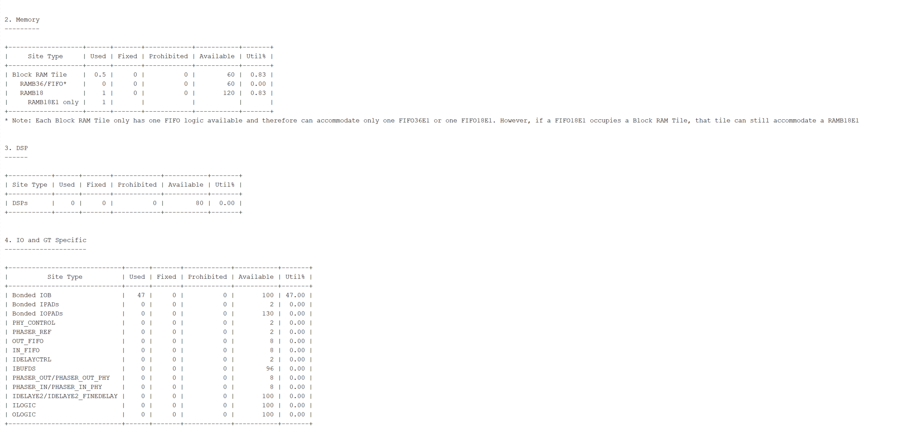
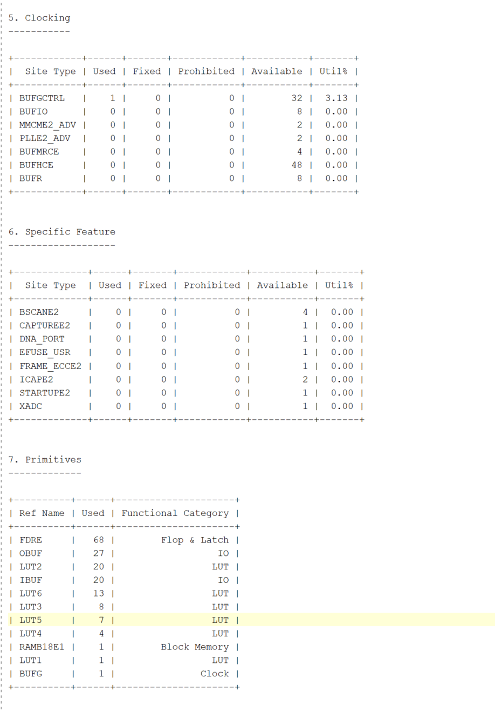
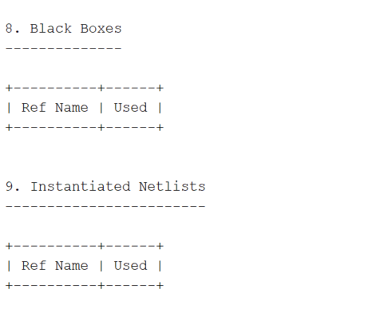
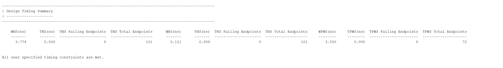

# Overview
This lab implements a queue using bram on Xilinx Vivado. The queue has a depth of 32 and a width of 16 bits. In total, the queue can store 512 bits. The queue has the ability to add a delay to the data when the data is being outputted. For example, a data can be outputted from the bram but will go through registers. The number of registers that the data goes through before reaching the output is controlled by the READ_LATENCY parameter. The output has a valid bit that will be driven high when new data is ready to be read. The project comes with a tcl file that can be ran in the Vivado TCL Console for efficient project bring up. Finally, a test bench is included with the project that tests the queue with 6 different test cases

# Design Summary
This design uses the bram ip with a depth of 32 to store 16 bit data. The circuit features combinational logic that adds needed checks to the block ram's enable input. For example, the read enable input on the bram ip is connected to an AND gate that checks that rst is 0, rd_en is 1, and that the queue is not empty. The write enable has a similar check. 

# Verification and Results
I verified my design by creating 6 different testbench tests. The test bench test 6 different scenarios. These scenarios are writing to every memory location and reading the correct pieces of data back, testing whether the output returns 0 when reset is asserted, writing all 1's and reading all 1's and than writing all 0's and reading all 0's, testing whether alternating bit patterns are read in the same order in which they were written in, testing whether the empty, full, almost_empty, and almost_full flags assert, and finally testing if the read and write enable signals work as intended.

## Utilization Report

## Timing Summary Report

# Known Issues or Limitations
The fifo does not work with a READ_LATENCY = 0.

# References
[Block RAM Information](https://docs.amd.com/r/en-US/ug573-ultrascale-memory-resources/Block-RAM-Summary)