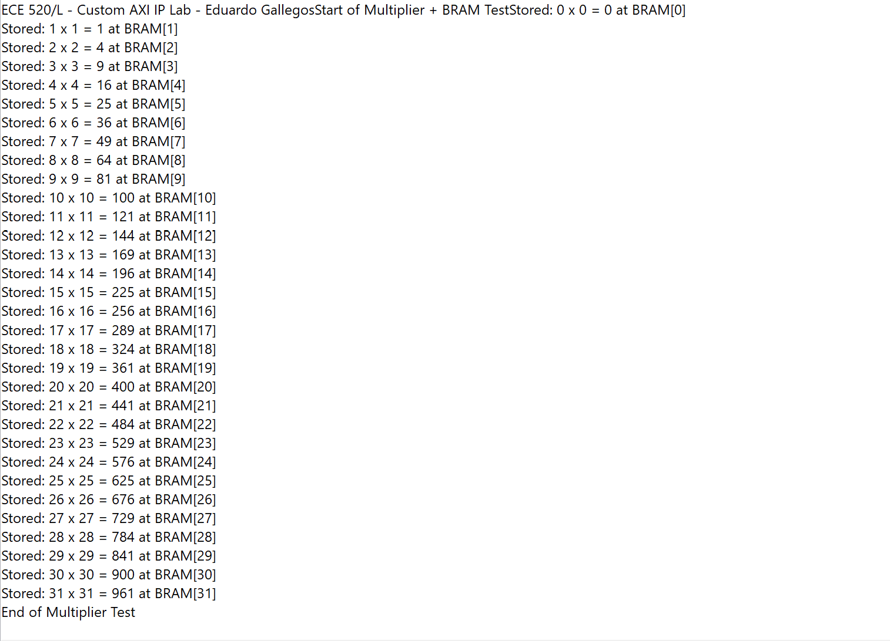
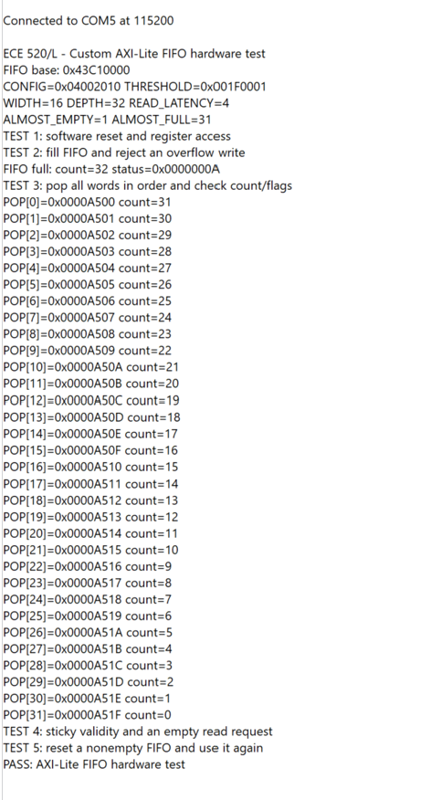
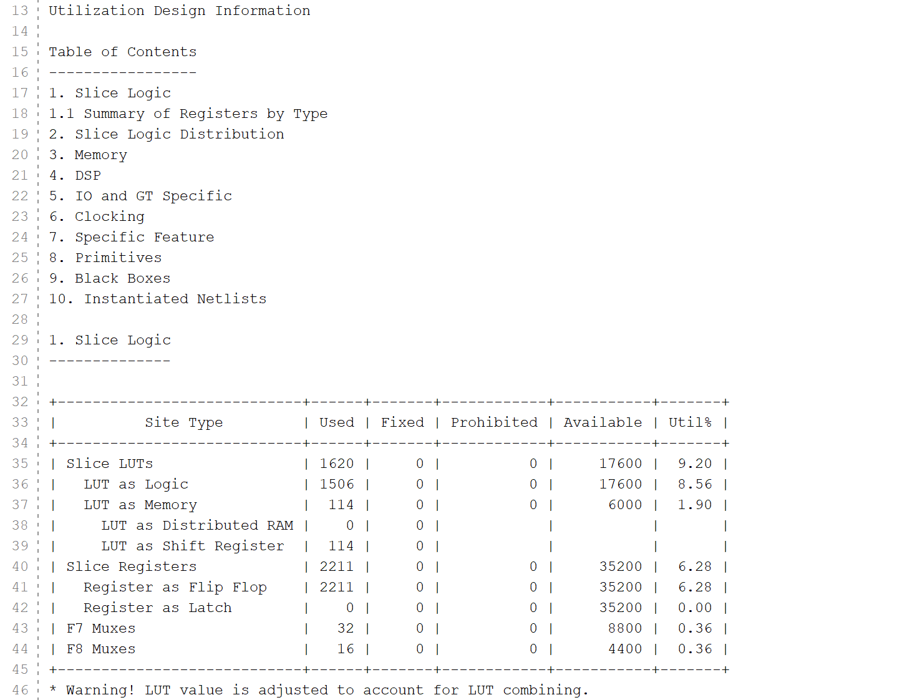
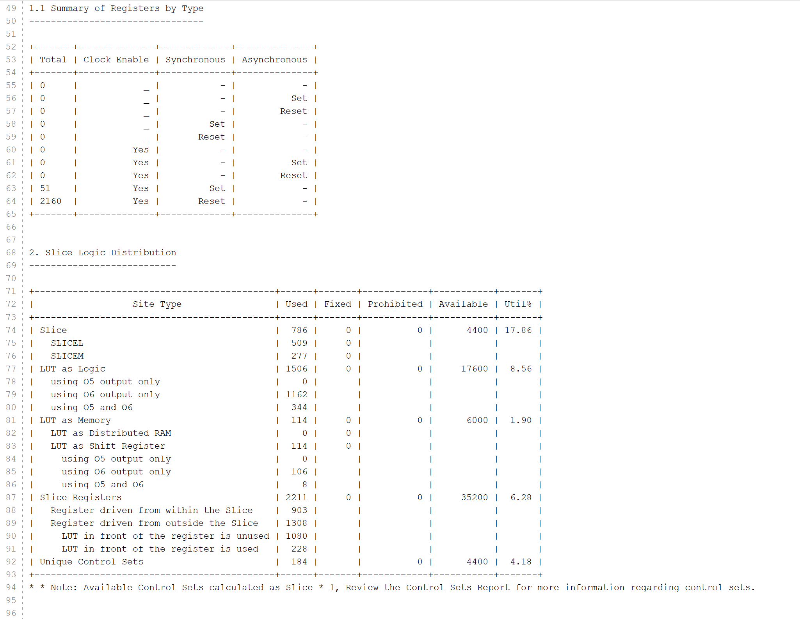
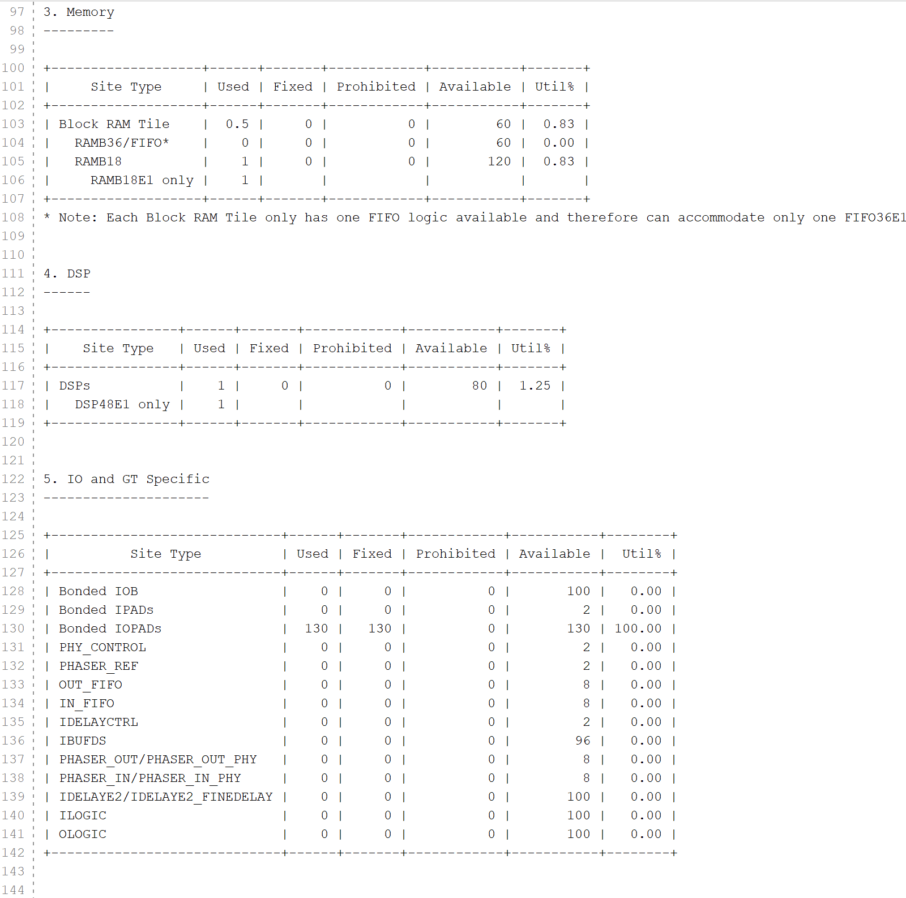
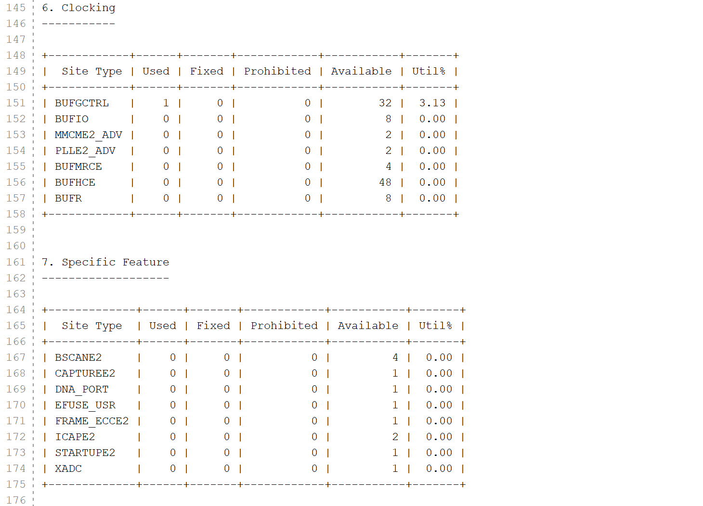
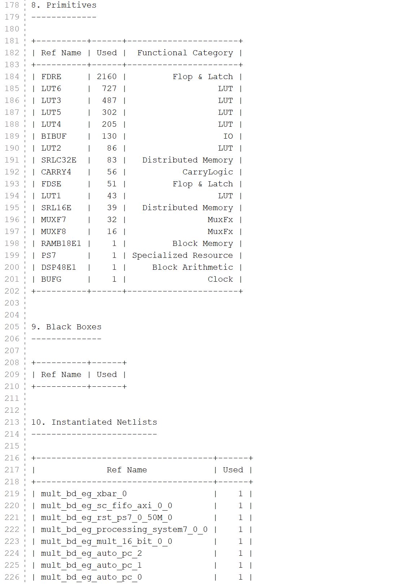
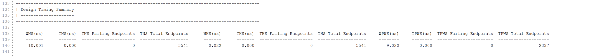

# Overview

This lab implements 2 custom AXI-Lite peripherals. The AXI-Lite allows a processor to control FPGA hardware through memory-mapped registers. The first IP core is a 16-bit multiplier which multiplies 2 16-bit unsigned inputs and outputs a registered 32-bit unsigned result. The second IP is a single-clock FIFO that stores up to 32 16-bit words that are stored in block RAM. The queue features read/write commands, storage count, and, reset along with full empty and threshold flags.

# Design Summary

The architecture is implemented using 2 RTL modules which are the 16-bit unsigned multiplier, and a 16-bit wide fifo with storage to hold 32 entries. Both RTL modules are connected to the processor through a AXI4-Lite slave interface. A set of memory-mapped registers provide the software access to the multipliers operands and result. The memory-mapped registers give the software access to the status and commands of the fifo, and the operands and results of the multiplier.  The multiplier's output is 32 bits. The fifo uses a simple dual-port block RAM. A read and write pointer are used to keep track of data. There's a counter that updates the status flags of the FIFO. An AXI command will generate 1 pulse so that each software write executes a FIFO operation.

# Verification and Results

## Multiplier / BRAM Test

## Multiplier / FIFO Test

## Utilization Report

## Timing Summary

# Known Issues or Limitations
No known issues or limitations.

# References
[Block RAM Information](https://docs.amd.com/r/en-US/ug573-ultrascale-memory-resources/Block-RAM-Summary)
[Zybo Z7](https://digilent.com/reference/programmable-logic/zybo-z7/start?srsltid=AYCX9vKc9fuj5nFy_76BSVL0tkSHV4Yjg7CE__kFGr0PJLb6IpLrEE1r)
