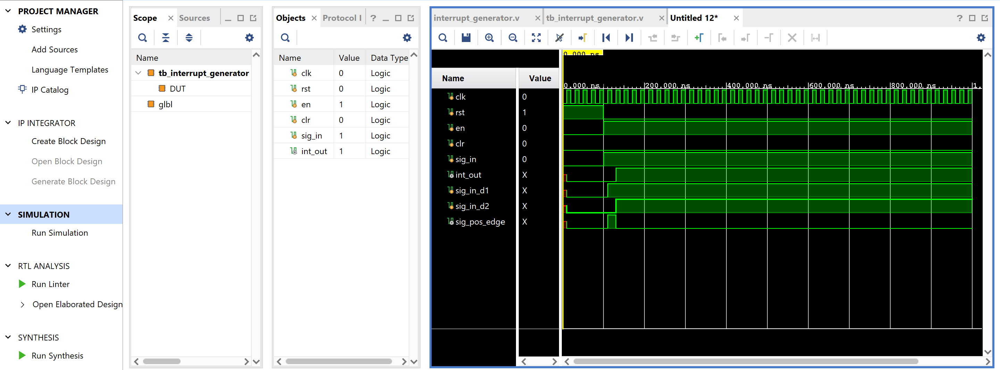
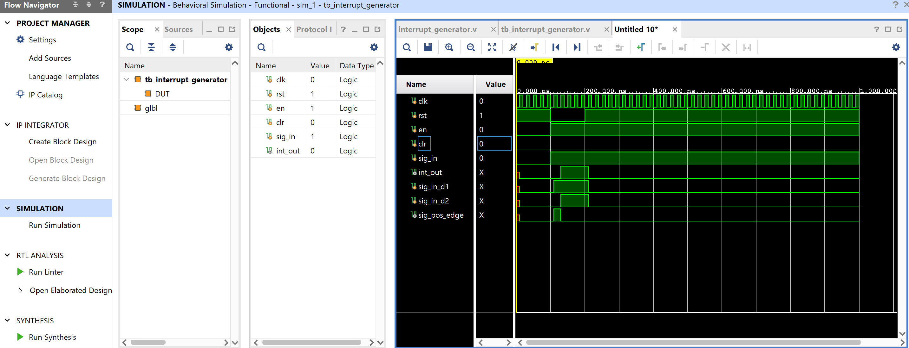
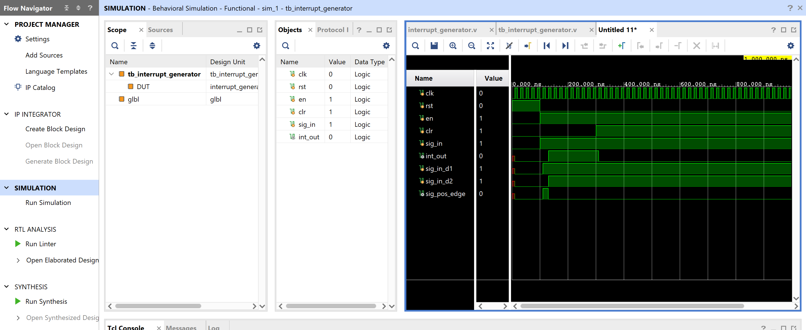
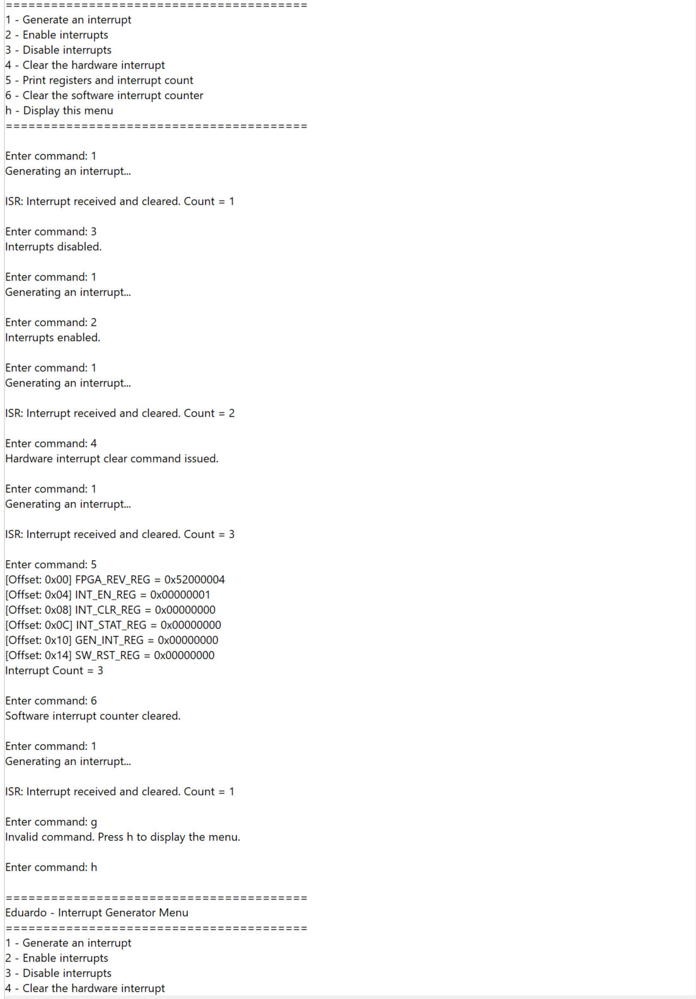
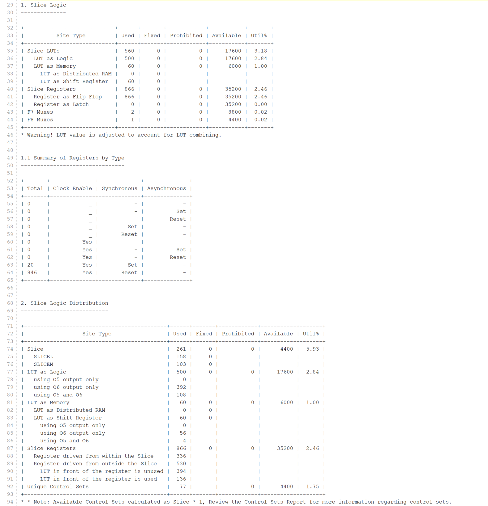
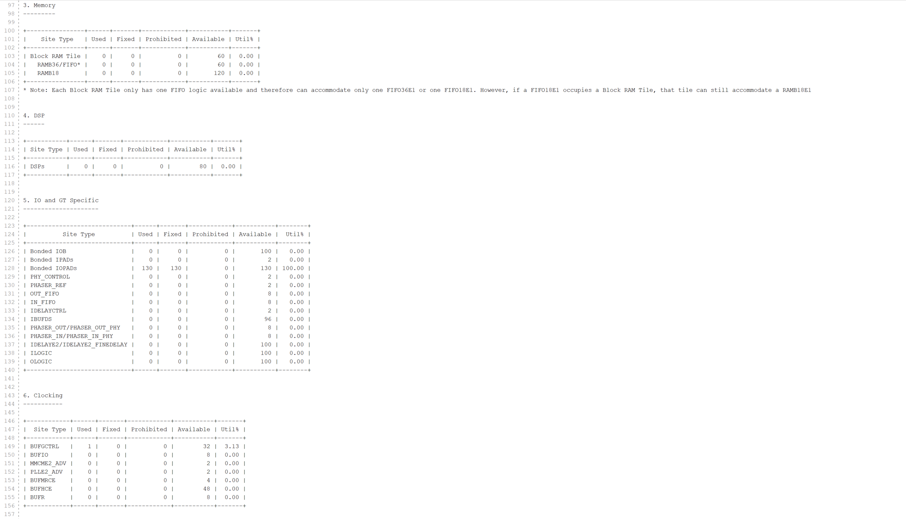
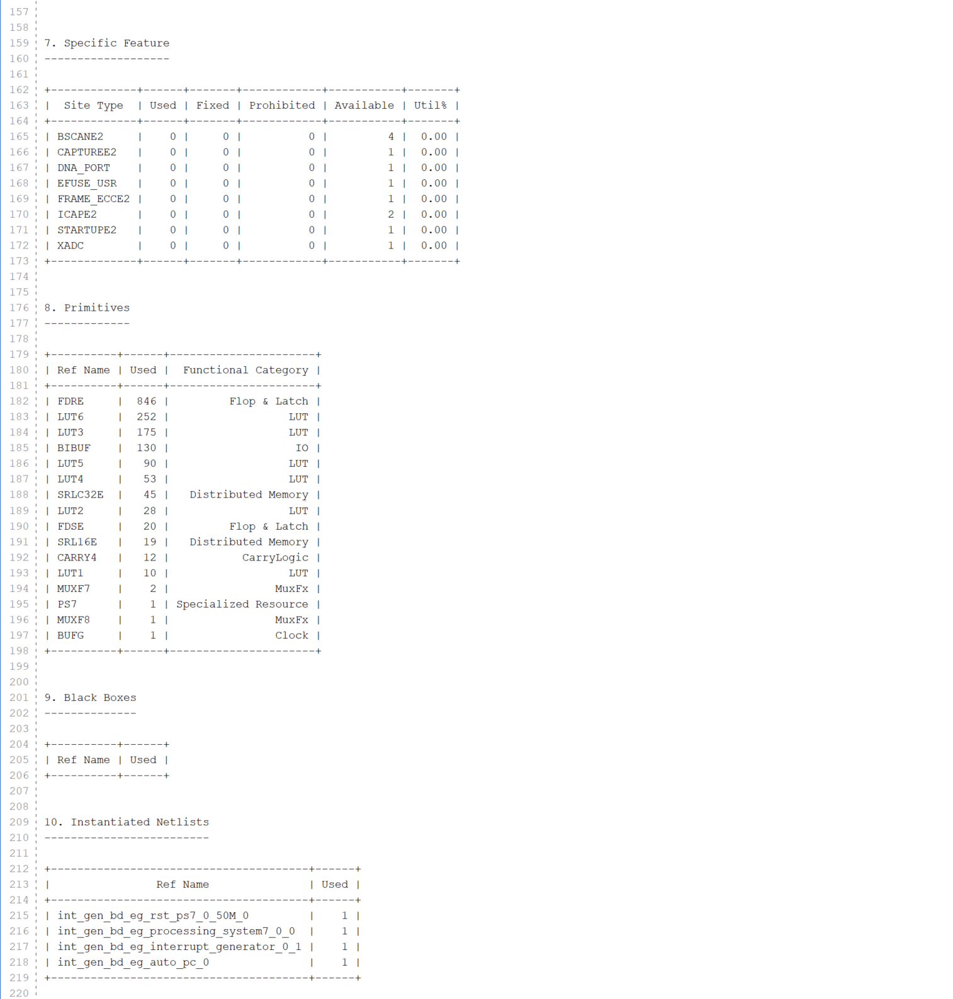
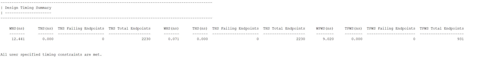

# Overview

This lab implements an interrupt generator on FPGA fabric. The interrupt generator uses AXI to send signals to the processor. AXI-LITE allows a processor to control the FPGA through the means of registers. A custom interrupt IP is made on Vivado.  We also export the xsa file to Vitis to test the interrupt generator. A user controlled test suite is created on Vitis where the user can generate interrupts, enable or disable interrupts, clear the interrupt generator, print the contents in the software counter and interrupt generator's FPGA registers, and clear the software counter. The software counter counts the number of interrupts that have been generated.

# Design Summary

The architecture is implemented using 1 RTL module and is driven by the rising edge of a clock. The interrupt IP features a active high reset signal that block interrupts when set. An interrupt clear input signal sets the output to 0 when enabled. The architecture also features an interrupt enable that lets the interrupt detect incoming events, it'll output logic high for one clock cycle. The interrupts generator inputs are connected to AXI registers.

# Verification and Results

## Interrupt Generator output with no clear or reset.

## Interrupt Generator output with reset

## Interrupt Generator output after clear

## Vitis Serial Terminal Verification

## Utilization Report

## Timing Summary

# Known Issues or Limitations
No known issues or limitations.

# References
[Block RAM Information](https://docs.amd.com/r/en-US/ug573-ultrascale-memory-resources/Block-RAM-Summary)
[Zybo Z7](https://digilent.com/reference/programmable-logic/zybo-z7/start?srsltid=AYCX9vKc9fuj5nFy_76BSVL0tkSHV4Yjg7CE__kFGr0PJLb6IpLrEE1r)
